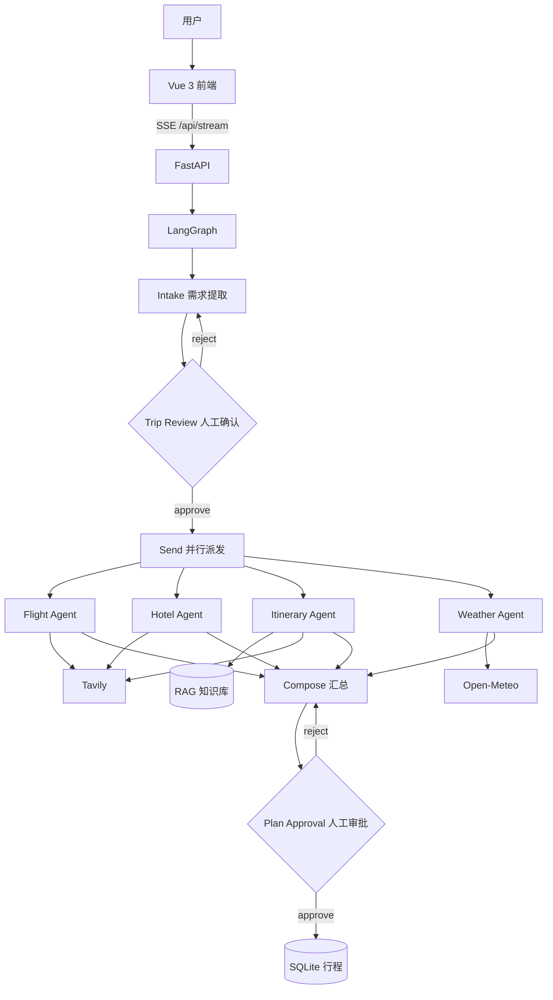

# AI Travel Agent

基于 **LangChain + LangGraph** 的多 Agent 旅行规划系统：一句自然语言需求，自动并行协调航班、酒店、行程、天气四个专家 Agent，结合本地 RAG 知识库生成可执行的 Markdown 行程，并在关键节点引入 Human-in-the-Loop 审批。

前端为 Vue 3 + Vite（复用同一套聊天/行程界面），后端为 FastAPI + LangGraph + SQLite，本地不需要 Redis、MySQL 或 Milvus。

## 功能

- **多 Agent 编排**：Supervisor 提取需求，LangGraph `Send` API 并行派发 4 个子 Agent
- **RAG 知识库**：LangChain 文档切分 + 可插拔 Embedding + SQLite 向量检索
- **Human-in-the-Loop**：行程信息确认、最终方案审批两次中断，支持驳回后带反馈重规划
- **流式输出**：SSE 推送节点进度、子 Agent 结论和最终计划 token
- **会话持久化**：LangGraph `AsyncSqliteSaver`，服务重启后可恢复审批现场
- **工具调用**：Tavily 实时搜索、Open-Meteo 天气、百度地图地理编码
- **开发友好**：手机号验证码登录（开发模式直接返回验证码），无需外部鉴权服务

## 架构



## 技术栈

| 层 | 技术 |
|---|---|
| Agent 编排 | LangGraph（StateGraph + Send 并行 + interrupt/resume） |
| LLM | LangChain + DeepSeek `deepseek-chat` |
| RAG | LangChain TextSplitter + DashScope / Ollama / 离线 hash embedding |
| 向量存储 | SQLite（余弦相似度，零外部依赖，适合个人项目） |
| 工具 | Tavily Search、Open-Meteo、百度地图 Geocoding |
| 后端 | FastAPI + Uvicorn + SSE |
| 状态 | LangGraph AsyncSqliteSaver + SQLite 用户/行程表 |
| 前端 | Vue 3 + Vite 5 |
| CI | GitHub Actions（pytest + 前端构建） |

## 快速开始

### 1. 环境

- Python 3.11+
- Node.js 18+
- [uv](https://docs.astral.sh/uv/)（推荐）

### 2. 配置

```bash
cp .env.example .env
```

至少填写：

```env
DEEPSEEK_API_KEY=sk-...
TAVILY_API_KEY=tvly-...
BAIDU_MAP_API_KEY=...
```

RAG 默认 `EMBED_PROVIDER=auto`：

- 配了 `DASHSCOPE_API_KEY` → 使用 DashScope 云端 embedding（推荐，语义检索效果好）
- 没配 → 使用离线 hash embedding，保证项目可跑通，但只适合演示

也可以显式使用本地 Ollama：

```env
EMBED_PROVIDER=ollama
OLLAMA_BASE_URL=http://localhost:11434
EMBED_MODEL=bge-m3
```

### 3. 安装依赖并构建知识库

```bash
uv sync
uv run ai-travel-agent ingest
```

### 4. 启动后端

```bash
uv run uvicorn ai_travel_agent.api:app --reload --port 8000
```

健康检查：<http://localhost:8000/api/health>

### 5. 启动前端

```bash
cd frontend
npm install
npm run dev
```

打开 <http://localhost:3000>，输入任意合法手机号，点击发送验证码。开发模式会在页面上直接显示 6 位验证码。\n\n地图为可选功能：复制 `frontend/.env.example` 为 `frontend/.env`，填入 `VITE_BAIDU_MAP_AK`；不填也能正常生成行程，只是底图不可用。

## Docker 启动

```bash
cp .env.example .env
# 填 Key 后：
docker compose up -d --build
```

打开 <http://localhost:8080>。数据持久化在 `./data`。

## API

| 方法 | 路径 | 说明 |
|---|---|---|
| GET | `/api/health` | 健康检查 |
| GET | `/api/status` | 依赖配置与 RAG 状态 |
| POST | `/api/auth/send-code` | 发送验证码（开发模式返回 `dev_code`） |
| POST | `/api/auth/login` | 登录并签发 token |
| GET | `/api/auth/me` | 校验 token |
| GET | `/api/stream/{thread_id}?message=...` | 启动规划并 SSE 流式返回 |
| GET | `/api/stream/resume/{thread_id}?action=approve\|reject` | 恢复 HITL 中断 |
| POST | `/api/rag/search` | 调试知识库检索 |
| POST | `/api/baidu/geocode-batch` | 批量地理编码（地图打点） |
| POST | `/api/feedback/{thread_id}` | 用户反馈 |

## 工作流

1. `intake`：LLM 提取目的地、天数、预算、日期、偏好
2. `review`：`interrupt()` 暂停，前端展示行程确认卡片
3. 用户确认 → `Send` 并行执行 4 个子 Agent
4. `compose`：整合研究结果，按固定 Markdown 模板生成行程
5. `approval`：再次 `interrupt()`，用户审批或带意见驳回
6. 驳回 → 回到 `compose` 重写；通过 → 保存 SQLite，返回最终结果

## RAG 设计

```text
data/knowledge/*.md
  → RecursiveCharacterTextSplitter(500/80)
  → Embedding（DashScope / Ollama / hash）
  → SQLite rag_chunks
  → 查询向量余弦相似度 top-k
  → Itinerary Agent 上下文
```

内置 8 个目的地的原创知识文档（巴黎、东京、曼谷、罗马、北京、上海、巴厘岛、纽约），无需额外准备数据即可体验。

## 项目结构

```text
AI-Travel-Agent/
├── src/ai_travel_agent/
│   ├── api.py          # FastAPI + SSE + 鉴权路由
│   ├── graph.py        # LangGraph 图定义
│   ├── agents.py       # Supervisor / 4 个子 Agent / Compose / HITL
│   ├── tools.py        # Tavily / 天气 / 百度地图 / 知识库工具
│   ├── rag.py          # 切分、Embedding、SQLite 向量检索
│   ├── prompts.py      # 提示词与 Markdown 行程模板
│   ├── models.py       # Pydantic 模型与 Graph State
│   ├── auth.py         # 开发模式 OTP + HMAC token
│   ├── db.py           # SQLite 表与读写
│   └── cli.py          # serve / ingest 命令
├── data/knowledge/     # RAG 种子文档
├── frontend/           # Vue 3 + Vite（复用的聊天/行程界面）
├── tests/              # pytest
├── docker-compose.yml
└── .github/workflows/ci.yml
```

## 评测

准备了一组 golden cases（`eval/cases.json`），脚本会自动跑完两次审批并统计：

- 目的地是否出现在计划中
- DAY 标题与预算表是否完整
- 是否包含天气建议
- 端到端耗时

```bash
uv run python scripts/eval.py
```

结果只打印到终端，请用你机器上的真实结果写简历，不要编数字。

## Windows 注意事项

如果 `uv` 报缓存目录权限错误：

```powershell
$env:UV_CACHE_DIR="$PWD\.uv-cache"
```

如果 `npm` 报缓存/EACCES/EPERM：

```powershell
$env:npm_config_cache="$PWD\.npm-cache"
```

## 测试

```bash
uv run pytest -q
```

覆盖：OTP/Token、RAG 检索、天气格式化、计划格式校验、API 鉴权与状态接口。

## 设计取舍

- **不用 Redis/MySQL/Milvus**：个人项目和本地演示优先零外部依赖；LangGraph checkpoint、行程记录、向量都放 SQLite。生产环境可替换为 Redis/Postgres/pgvector。
- **RAG 用 SQLite 暴力余弦**：数据量 <1 万片段时足够快，换来部署简单；数据量上来后换 FAISS/Milvus。
- **开发模式登录**：不接短信供应商，验证码直接返回，方便演示；生产环境必须接真实短信并做限流。
- **固定 Markdown 模板**：前端能稳定解析 DAY/预算表；Compose 节点会校验格式并在不合法时重试一次。

## 已知限制

- 开发模式验证码不是生产级鉴权
- 离线 hash embedding 只有词面匹配能力，语义检索请配置 DashScope 或 Ollama
- 航班/酒店价格为搜索结果估算，不作为下单依据
- 百度地图需要 `VITE_BAIDU_MAP_AK` 才能显示真实底图，未配置时使用前端内置坐标兜底

## License

MIT


