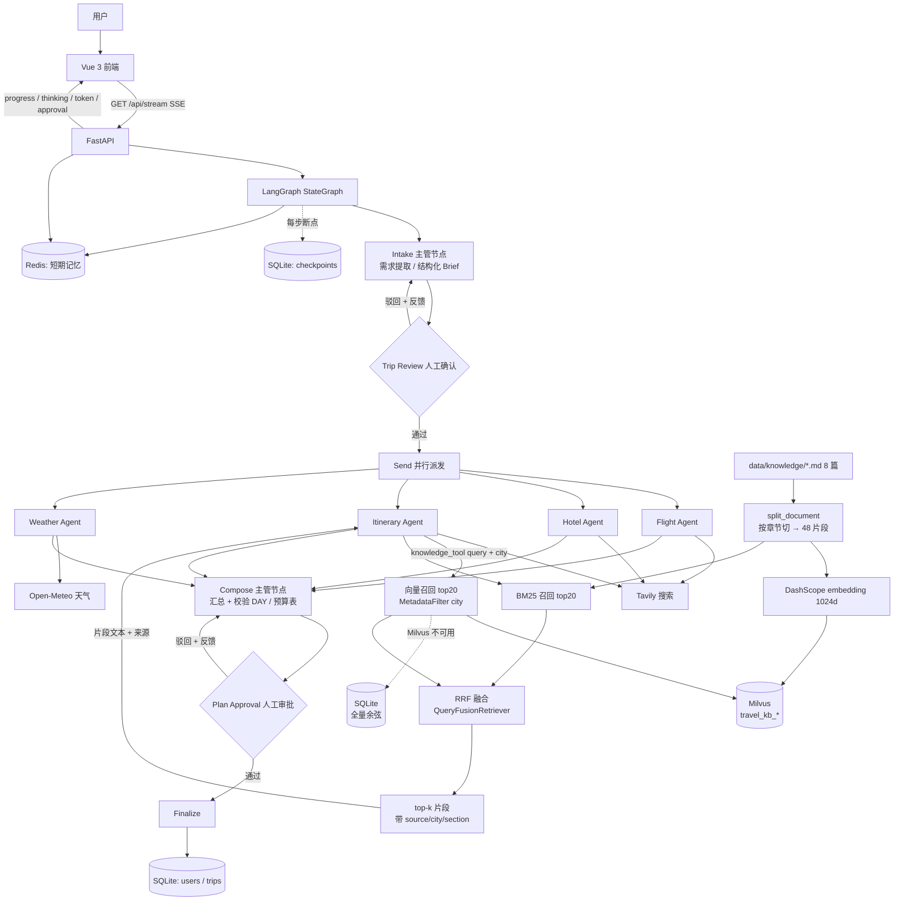

# AI Travel Agent

基于 **LangChain + LangGraph** 的多 Agent 旅行规划系统：一句自然语言需求，自动并行协调航班、酒店、行程、天气四个专家 Agent，结合本地 RAG 知识库生成可执行的 Markdown 行程，并在关键节点引入 Human-in-the-Loop 审批。

前端为 Vue 3 + Vite（复用同一套聊天/行程界面），后端为 FastAPI + LangGraph。Redis 负责登录鉴权和短期记忆；RAG 检索层基于 LlamaIndex，向量默认存 Milvus（`RAG_BACKEND=sqlite` 时回退 SQLite）；长期行程与 LangGraph 断点存 SQLite，不需要 MySQL。

## 功能

- **多 Agent 编排**：Supervisor 提取需求，LangGraph `Send` API 并行派发 4 个子 Agent
- **RAG 知识库**：章节结构化切分 + 可插拔 Embedding + LlamaIndex 检索层（Milvus / SQLite 双后端）+ BM25 混合召回
- **Human-in-the-Loop**：行程信息确认、最终方案审批两次中断，支持驳回后带反馈重规划
- **流式输出**：SSE 推送节点进度、子 Agent 结论和最终计划 token
- **Redis 短期记忆**：按 thread 保存最近对话，达到上限自动压缩成滚动摘要，只保留最近 6 条
- **历史对话**：每次新建行程都是独立 thread，可在「历史对话」页回看、接着聊或删除
- **Redis 登录鉴权**：验证码、token 都存在 Redis，token 可注销，TTL 自动过期
- **状态持久化**：LangGraph `AsyncSqliteSaver`，服务重启后可恢复 HITL 审批现场
- **工具调用**：Tavily 实时搜索、Open-Meteo 天气、百度地图地理编码
- **可观测性**：可选 LangSmith 全链路追踪，配置 `LANGSMITH_API_KEY` 即启用

## 架构



主管 Agent 没有独立节点：需求提取（`intake`）和最终汇总（`compose`）都用 `SUPERVISOR_MODEL`，分派与回退由 `review`、`approval` 之后的条件边决定。这样少一次 LLM 调用，编排逻辑仍然可控。

## 界面

| 灵感页 · 一句话开始规划 | 行程页 · 每日行程 + 地图 |
|---|---|
|  |  |

| 我的旅行 · 账号内保存的行程 | 历史对话 · 回看 / 继续 / 删除 |
|---|---|
|  |  |

## 技术栈

| 层 | 技术 |
|---|---|
| Agent 编排 | LangGraph（StateGraph + Send 并行 + interrupt/resume） |
| LLM | LangChain + DeepSeek `deepseek-chat` |
| RAG | LlamaIndex（TextNode + VectorIndexRetriever + BM25Retriever + QueryFusionRetriever/RRF）+ DashScope / Ollama / 离线 hash embedding |
| 向量存储 | Milvus（Lite，主）/ SQLite（余弦相似度，零依赖兜底） |
| 工具 | Tavily Search、Open-Meteo、百度地图 Geocoding |
| 后端 | FastAPI + Uvicorn + SSE |
| 短期记忆 | Redis List + 滚动摘要（达到 12 条触发压缩，保留最近 6 条） |
| 登录鉴权 | Redis OTP + 随机 opaque token（可注销，30 天 TTL） |
| 长期记忆 | SQLite `users` / `trips` 表，只保存审批通过的行程 |
| 状态 | LangGraph AsyncSqliteSaver（HITL 断点恢复）+ Redis 对话缓冲 |
| 前端 | Vue 3 + Vite 5 |
| CI | GitHub Actions（pytest + 前端构建） |

## 快速开始

> 完整的启动顺序（Redis → Milvus → 后端 → 前端）、一键脚本与常见问题见 [docs/STARTUP.md](docs/STARTUP.md)。

### 1. 环境

- Python 3.11+
- Node.js 18+
- Redis（本机默认 `127.0.0.1:6379`）
- [uv](https://docs.astral.sh/uv/)（推荐）

确认 Redis 可用：

```powershell
Test-NetConnection 127.0.0.1 -Port 6379
```

### 2. 配置

```bash
cp .env.example .env
```

至少填写：

```env
DEEPSEEK_API_KEY=sk-...
TAVILY_API_KEY=tvly-...
BAIDU_MAP_API_KEY=...
```

Redis 默认使用本机 `127.0.0.1:6379`，可在 `.env` 修改：

```env
REDIS_HOST=127.0.0.1
REDIS_PORT=6379
REDIS_DB=0
REDIS_PASSWORD=
```

RAG 默认 `EMBED_PROVIDER=auto`：

- 配了 `DASHSCOPE_API_KEY` → 使用 DashScope 云端 embedding（推荐，语义检索效果好）
- 没配 → 使用离线 hash embedding，保证项目可跑通，但只适合演示

也可以显式使用本地 Ollama：

```env
EMBED_PROVIDER=ollama
OLLAMA_BASE_URL=http://localhost:11434
EMBED_MODEL=bge-m3
```

### 3. 安装依赖并构建知识库

```bash
uv sync
uv run ai-travel-agent ingest
```

### 4. 启动后端

```bash
uv run uvicorn ai_travel_agent.api:app --reload --port 8000
```

健康检查：<http://localhost:8000/api/health>

### 5. 启动前端

```bash
cd frontend
npm install
npm run dev
```

打开 <http://localhost:3000>，输入任意合法手机号，点击发送验证码。开发模式会在页面上直接显示 6 位验证码。

地图为可选功能：复制 `frontend/.env.example` 为 `frontend/.env`，填入 `VITE_BAIDU_MAP_AK`；不填也能正常生成行程，只是底图不可用。

## Docker 启动

```bash
cp .env.example .env
# 填 Key 后：
docker compose up -d --build
```

打开 <http://localhost:8080>。数据持久化在 `./data`。

## API

| 方法 | 路径 | 说明 |
|---|---|---|
| GET | `/api/health` | 健康检查 |
| GET | `/api/status` | 依赖配置与 RAG 状态 |
| POST | `/api/auth/send-code` | 发送验证码（开发模式返回 `dev_code`） |
| POST | `/api/auth/login` | 登录并签发 token |
| GET | `/api/auth/me` | 校验 token |
| GET | `/api/stream/{thread_id}?message=...` | 启动规划并 SSE 流式返回 |
| GET | `/api/stream/resume/{thread_id}?action=approve\|reject` | 恢复 HITL 中断 |
| POST | `/api/rag/search` | 调试知识库检索 |
| POST | `/api/baidu/geocode-batch` | 批量地理编码（地图打点） |
| POST | `/api/feedback/{thread_id}` | 用户反馈 |
| GET | `/api/threads` | 当前账号的历史对话列表 |
| GET | `/api/threads/{thread_id}/messages` | 读取某个对话的消息 |
| DELETE | `/api/threads/{thread_id}` | 删除对话（记忆 + 断点） |
| GET | `/api/trips` | 当前账号已保存的行程列表 |
| DELETE | `/api/trips/{trip_id}` | 删除自己的行程，同时删掉对应会话（非本人返回 404） |

## 工作流

1. `intake`：LLM 提取目的地、天数、预算、日期、偏好
2. `review`：`interrupt()` 暂停，前端展示行程确认卡片
3. 用户确认 → `Send` 并行执行 4 个子 Agent
4. `compose`：整合研究结果，按固定 Markdown 模板生成行程
5. `approval`：再次 `interrupt()`，用户审批或带意见驳回
6. 驳回 → 回到 `compose` 重写；通过 → 保存 SQLite，返回最终结果

## RAG 设计

```text
data/knowledge/*.md
  → 按 Markdown 标题切主题，主题内再按 500/80 切块（8 篇 → 48 个片段）
  → 每个片段带 city / section 元数据，embedding 时拼上「城市 主题」前缀
  → Embedding（DashScope / Ollama / hash）
  → SQLite rag_chunks
  → 城市过滤 → 向量 + BM25 双路召回 → RRF 排名融合 → top-k
  → Itinerary Agent 上下文（带来源文件名）
```

内置 8 个目的地的原创知识文档（巴黎、东京、曼谷、罗马、北京、上海、巴厘岛、纽约），无需额外准备数据即可体验。

### 向量库与 LlamaIndex（可选）

默认 `RAG_BACKEND=sqlite`，零依赖即可运行；切到 `RAG_BACKEND=milvus` 后检索走 LlamaIndex + Milvus：

- 节点：`TextNode(text, metadata={source, city, section})`，复用同一套章节切分
- 召回：`VectorIndexRetriever`（Milvus）+ `BM25Retriever` 双路，`QueryFusionRetriever(mode="reciprocal_rerank")` 做 RRF 融合
- 过滤：`MetadataFilters(city=...)` 先按城市收窄，再做召回

本地起 Milvus（WSL2 Ubuntu，不需要 Docker）：

```bash
python3 -m venv ~/milvus-venv
~/milvus-venv/bin/pip install -U milvus
~/milvus-venv/bin/milvus-server --data ~/milvus-data
```

Windows 侧取 WSL 的 IP（重启 WSL 后会变）：

```powershell
wsl -d Ubuntu -- ip -4 addr show eth0
```

写入 `.env`：

```env
RAG_BACKEND=milvus
MILVUS_URI=http://<WSL-IP>:19530
```

启动顺序（每次开机）：Redis → Milvus → 后端 → 前端。Windows 侧可一键：

```powershell
powershell -ExecutionPolicy Bypass -File scripts\dev_up.ps1
```

（脚本会读取 WSL 的 IP、同步 `.env` 里的 `MILVUS_URI`、启动 Redis 与 `milvus-server`）

降级：`RAG_BACKEND=milvus` 但 Milvus 连不上时，`get_kb()` 会打一条 warning 并自动回退到 SQLite 检索，服务照常启动；`/api/health` 的 `rag_backend` 字段会显示实际使用的后端。

两种后端跑同一套 24 条评测：

| 后端 | 文档 Recall@3 | 章节命中@3 |
|---|---|---|
| SQLite（默认） | 1.000 | 1.000 |
| Milvus + LlamaIndex | 1.000 | 1.000 |

### 检索评测

`eval/retrieval_cases.json` 有 24 条「问题 → 期望文档/章节」标注，`scripts/eval_rag.py` 计算文档召回、章节命中与 MRR：

```powershell
uv run python scripts/eval_rag.py --compare          # 向量 vs 混合
uv run python scripts/eval_rag.py --mode vector --no-city
```

| 配置 | 文档 Recall@3 | 章节命中@3 |
|---|---|---|
| 纯向量，无城市过滤 | 0.875 | 0.875 |
| 纯向量 + 城市过滤 | 1.000 | 0.958 |
| 混合检索（BM25 + 向量 + RRF）+ 城市过滤 | 1.000 | 1.000 |

向量检索对 `Navigo Easy`、`Suica`、`Airport Rail Link` 这类专有名词不敏感，混合检索补上了这一块。


## 记忆系统

### 短期记忆（Redis）

每个会话 thread 对应两个 Redis key：

```text
travel:chat:{thread_id}:messages  -> List，最近对话
travel:chat:{thread_id}:summary   -> String，压缩后的历史摘要
```

- 每次用户发消息、生成最终方案，都会追加到 List
- 达到 `SHORT_TERM_MAX_MESSAGES=12` 时触发压缩
- 用 DeepSeek 把较旧的对话压成 300 字摘要，只保留最近 `SHORT_TERM_KEEP_MESSAGES=6` 条
- 摘要和最近对话会注入需求提取 Prompt，所以“改成 3 天”“预算降到 8000”这类追问能理解上下文
- key 默认 7 天 TTL，避免 Redis 无限增长

### 长期记忆（SQLite）

只有最终方案审批通过后才写入 `trips` 表：

```sql
trips(id, user_id, thread_id, brief, plan, created_at)
```

需求提取时读取最近 2 条行程的 `brief` 作为偏好参考，不保存每条聊天记录。

### 状态持久化（SQLite）

LangGraph 的 HITL 中断状态由 `AsyncSqliteSaver` 存在 `data/checkpoints.db`，保证两次审批可以跨 HTTP 请求恢复。每轮完成后只保留最新 checkpoint。

## 项目结构

```text
AI-Travel-Agent/
├── src/ai_travel_agent/
│   ├── api.py          # FastAPI + SSE + 鉴权路由
│   ├── graph.py        # LangGraph 图定义
│   ├── agents.py       # Supervisor / 4 个子 Agent / Compose / HITL
│   ├── tools.py        # Tavily / 天气 / 百度地图 / 知识库工具
│   ├── rag.py          # 章节切分、Embedding、SQLite 检索（兜底）
│   ├── rag_milvus.py   # LlamaIndex + Milvus 检索后端
│   ├── prompts.py      # 提示词与 Markdown 行程模板
│   ├── models.py       # Pydantic 模型与 Graph State
│   ├── auth.py         # Redis OTP + 可注销 token
│   ├── memory.py       # Redis 短期记忆 + 滚动摘要压缩
│   ├── db.py           # SQLite 用户/长期行程表与读写
│   └── cli.py          # serve / ingest 命令
├── data/knowledge/     # RAG 种子文档
├── frontend/           # Vue 3 + Vite（复用的聊天/行程界面）
├── scripts/            # eval_rag.py 检索评测、dev_up.ps1 一键启动
├── docs/               # 启动指南 STARTUP.md
├── tests/              # pytest
├── docker-compose.yml
└── .github/workflows/ci.yml
```

## 评测

准备了一组 golden cases（`eval/cases.json`），脚本会自动跑完两次审批并统计：

- 目的地是否出现在计划中
- DAY 标题与预算表是否完整
- 是否包含天气建议
- 端到端耗时

```bash
uv run python scripts/eval.py
```

结果只打印到终端，请用你机器上的真实结果写简历，不要编数字。

## Windows 注意事项

如果 `uv` 报缓存目录权限错误：

```powershell
$env:UV_CACHE_DIR="$PWD\.uv-cache"
```

如果 `npm` 报缓存/EACCES/EPERM：

```powershell
$env:npm_config_cache="$PWD\.npm-cache"
```

## 测试

```bash
uv run pytest -q
```

覆盖：Redis OTP/Token/注销、短期记忆压缩、RAG 检索、计划格式校验、API 鉴权与状态接口。

## 设计取舍

- **Redis / Milvus / SQLite 分工**：Redis 负责需要 TTL 的登录状态与短期对话；Milvus 承载 RAG 向量与元数据过滤；SQLite 负责长期行程、LangGraph 断点，以及 Milvus 不可用时的检索兜底。
- **RAG 双后端**：默认 SQLite 全量余弦，零依赖即可运行；`RAG_BACKEND=milvus` 时走 LlamaIndex + Milvus。48 个片段本身用不上 ANN，迁移动机是元数据过滤、增量更新与多用户并发；两个后端共用同一套章节切分和 24 条评测。
- **开发模式登录**：不接短信供应商，验证码直接返回，方便演示；生产环境必须接真实短信并做限流。
- **固定 Markdown 模板**：前端能稳定解析 DAY/预算表；Compose 节点会校验格式并在不合法时重试一次。

## 技术栈使用情况

| 技术 | 是否使用 | 说明 |
|---|---|---|
| Human-in-the-Loop | ✅ 使用 | LangGraph `interrupt()` 两次中断：行程确认、最终方案审批 |
| LangSmith | ✅ 可选 | 配置 `LANGSMITH_API_KEY` 后自动开启 LangChain 全链路追踪；未配置时不启用 |
| LlamaIndex | ✅ 使用 | RAG 检索层：`TextNode` + `VectorIndexRetriever` + `BM25Retriever` + `QueryFusionRetriever`（RRF） |
| Milvus | ✅ 可选 | `RAG_BACKEND=milvus` 时作为向量库（Milvus Lite，WSL 本地部署）；连不上时自动回退 SQLite |
| BM25 | ✅ 使用 | 关键词召回通道，与向量结果做 RRF 融合；补齐专有名词/交通代号类查询 |
| Redis | ✅ 使用 | 验证码、token、短期记忆与压缩摘要 |

## 已知限制

- 开发模式验证码不是生产级鉴权，生产环境需接真实短信通道
- 离线 hash embedding 只有词面匹配能力，语义检索请配置 DashScope 或 Ollama
- 航班/酒店价格为搜索结果估算，不作为下单依据
- Milvus 目前是 Milvus Lite（`milvus-server`，WSL 本地），不是生产集群；生产可换 standalone/集群，只需改 `MILVUS_URI`
- 百度地图需要 `VITE_BAIDU_MAP_AK` 才能显示真实底图，未配置时使用前端内置坐标兜底

## License

MIT


